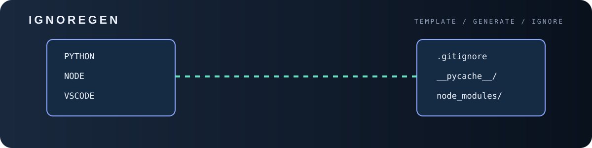

<p align="center">

<p align="center"></p>
  
</p>

**ignoregen** builds a clean `.gitignore` from built-in templates in one command. One Python file, zero dependencies, works offline.

## Usage

```bash
python3 ignoregen.py python node macos vscode > .gitignore
```

Or write straight to a file:

```bash
python3 ignoregen.py python env -o .gitignore          # refuses to overwrite
python3 ignoregen.py go linux -o .gitignore --append   # only adds missing lines
python3 ignoregen.py rust -o .gitignore --force        # overwrite
```

Duplicate lines across templates are removed automatically.

## Templates

```bash
python3 ignoregen.py --list
```

`python` `node` `java` `go` `rust` `c` `dotnet` `php` `ruby` `macos` `windows` `linux` `vscode` `jetbrains` `env` `logs`

Handy aliases work too: `py`, `js`, `ts`, `mac`, `win`, `cpp`, `csharp`, `idea`, `code`.

## Options

| Option | What it does |
| --- | --- |
| `-l`, `--list` | List all templates |
| `-o FILE` | Write to a file instead of stdout |
| `-a`, `--append` | With `-o`: add only the lines the file is missing |
| `-f`, `--force` | With `-o`: overwrite an existing file |

Typos are caught with a suggestion, e.g. `pyton` gives *did you mean 'python'?*

## Requirements

Python 3.8+. Nothing to install.